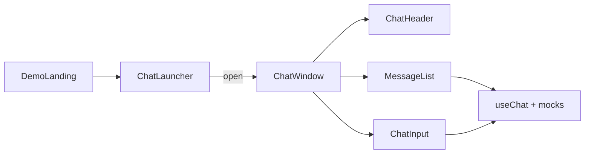

# Frontend чата ИИ-агента в стиле Jivo

## Контекст

Репозиторий сейчас пустой (кроме [`.cursor/rules/mock-data.mdc`](.cursor/rules/mock-data.mdc)). Реализация — **с нуля**: **Vite + React (JavaScript)**, без TypeScript, чтобы быстро собрать UI и потом подключить API одной точкой.

## Референс UX (Jivo)



| Элемент | Поведение |
|---------|-----------|
| Плавающая кнопка | Правый нижний угол, иконка чата, счётчик непрочитанных при закрытом окне |
| Окно чата | ~380×520px, скругления, тень, анимация появления |
| Шапка | Аватар агента, имя («ИИ-ассистент»), статус «В сети», свернуть/закрыть |
| Лента | Приветствие, пузыри (агент слева, пользователь справа), время, индикатор «печатает…» |
| Быстрые ответы | 3–4 чипа под приветствием (как у Jivo) |
| Поле ввода | Текст + Enter / кнопка отправки, блокировка на время «ответа» |

## Структура файлов

```
ai-chat/
  package.json
  vite.config.js
  index.html
  src/
    main.jsx
    App.jsx
    pages/DemoLanding.jsx          # фоновый лендинг (hero, фичи)
    components/chat/
      ChatWidget.jsx               # launcher + window, состояние open/unread
      ChatLauncher.jsx
      ChatWindow.jsx
      ChatHeader.jsx
      MessageList.jsx
      MessageBubble.jsx
      ChatInput.jsx
      TypingIndicator.jsx
      QuickReplies.jsx
    hooks/useChat.js               # sendMessage, typing, mock-ответ
    context/ThemeContext.jsx       # light/dark + localStorage
    mocks/
      agent.js                     # профиль агента
      responses.js                 # ответы по ключам / fallback
      initialConversation.js       # стартовые сообщения
    styles/
      tokens.css                   # CSS-переменные для обеих тем
      global.css
      chat.css
```

## Мок-данные и «ИИ» без API

Следуя правилу моков:

- [`src/mocks/initialConversation.js`](src/mocks/initialConversation.js) — приветственное сообщение агента + метаданные сессии.
- [`src/mocks/responses.js`](src/mocks/responses.js) — 5–8 осмысленных ответов на русском; простая логика в `useChat`: задержка 800–1500 ms, `typing`, затем ответ по ключевым словам или общий fallback («Расскажите подробнее…»).
- Флаг `USE_MOCK_DATA = true` в [`src/hooks/useChat.js`](src/hooks/useChat.js) — единая точка замены на `fetch('/api/chat')` позже.

Быстрые ответы: «Цены», «Как подключить», «Связаться с человеком» — отправляют текст как сообщение пользователя.

## Темы

- [`src/context/ThemeContext.jsx`](src/context/ThemeContext.jsx): `theme` (`light` | `dark`), `toggleTheme`, сохранение в `localStorage`.
- [`src/styles/tokens.css`](src/styles/tokens.css): переменные (`--chat-accent` в духе зелёного Jivo для light, приглушённый акцент для dark).
- Переключатель: в шапке виджета **и** на демо-лендинге (иконка солнце/луна), `data-theme` на `document.documentElement`.

## Демо-лендинг

[`src/pages/DemoLanding.jsx`](src/pages/DemoLanding.jsx) — простая страница (заголовок, 2–3 блока текста, CTA «Открыть чат»), чтобы виджет выглядел как на реальном сайте. [`src/App.jsx`](src/App.jsx) рендерит лендинг + `<ChatWidget />`.

## Стили и доступность

- Mobile: на узком экране окно на всю ширину снизу (max-height ~85vh), кнопка остаётся в углу.
- `aria-label` на launcher, `role="log"` на ленте, фокус в поле ввода при открытии окна.
- Плавный автоскролл к последнему сообщению.

## Запуск

```bash
npm create vite@latest . -- --template react
npm install
npm run dev
```

(При инициализации в непустой папке — создать файлы вручную по структуре выше, без перезаписи `.cursor`.)

## Вне scope (следующий этап)

- Реальный LLM/API, WebSocket, загрузка файлов, мультиязычность, embed-snippet для сторонних сайтов.
- Тесты и CI — по запросу.

## Проверка после реализации

1. Открыть демо: виджет закрыт, на кнопке badge после «непрочитанного» приветствия (опционально при первом визите).
2. Открыть чат: приветствие, quick replies, отправка текста и чипа — ответ с задержкой и typing.
3. Переключить тему — виджет и лендинг меняются, перезагрузка сохраняет выбор.
4. Свернуть/закрыть — состояние сообщений сохраняется в сессии (React state).
